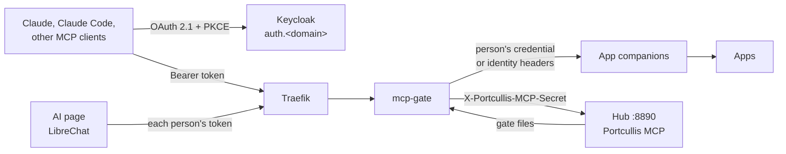

# AI Support

People can use their Portcullis apps from Claude, Claude Code or another MCP
client, and from an AI page, **as themselves**: the AI gets exactly the
person's rights in each app, signs in with the person's passkey, and every
request is checked and logged by core's **mcp-gate**. This page is the
administrator's guide. What people see is in
[Connect your AI](../guides/connect-your-ai.md); the interfaces are in
[contracts §15](../guides/integration-contracts.md#15-ai-support-mcp-new-ai-support).

AI support is **off** on a new install. Nothing reaches an app through MCP
until you switch the master switch on *and* switch AI support on for that app.

## How it fits together

Each MCP endpoint is its own OAuth resource with its own scope:

| Endpoint | Who | What |
|----------|-----|------|
| `https://<app host>/mcp` (an app's **companion**) | the app's users (its settings population) | the app, as the person |
| `https://mcp.<domain>/mcp` (**All my apps**) | every signed-in person | every companion they can use plus their Portcullis account tools, one connection |
| `https://people.<domain>/mcp` (**Portcullis**) | every signed-in person | their own account and apps; delegated people management for delegates |
| `https://hub.<domain>/mcp` (**Portcullis (admin)**) | `lldap_admin` members, only through clients you enable it for | the Hub: instances, settings, users and groups, backups, the doctor |

A token is minted for exactly one of them: a token whose audience names two
resources is refused at both, so an MCP client asks for one resource's scope
per token (checked by core's `e2e-ai` job on Keycloak 26.8.1).

A **companion** is the MCP server the AI talks to for one app: the app's
built-in MCP server or the upstream project's (or a vetted community
project's) published image, pinned by digest. Portcullis never writes MCP
servers for apps; templates declare their companions in the
[`ai:` block](../guides/manifest-reference.md#ai), and each app's catalog page
has an **AI support** section.

## Before you start: reachability

- **Claude desktop, claude.ai and Claude mobile connect from Anthropic's
  servers** (`160.79.104.0/21`), not from the person's device. For them,
  `auth.<domain>` and every app host people connect to must be reachable from
  the internet. Settings → AI says so. Claude Code and other local clients
  connect from the person's machine, so a LAN-only install works for them.
- **No client certificate.** No MCP client can present the person's YubiKey
  certificate, so an app whose effective policy needs mTLS (LoA 3) can't get
  AI support (the switch is refused with "needs a client certificate on every
  request; AI clients can't present one"). Saving a policy that reaches LoA 3
  switches AI support off on that app first, and the preview lists it.
- **Rate limits are per person**, not per IP: every hosted Claude user comes
  from Anthropic's range. Core's `rate-limit@file` (per source IP) still
  stays in front of every MCP router and is shared by everyone whose client
  runs in Anthropic's cloud.

## Settings → AI

| Setting | Default | What it does |
|---------|---------|--------------|
| **AI support** (master switch) | off | Off: the gate answers every AI request `503` "AI support is off on this Portcullis", the apps' AI switches are greyed out and people's "Connect your AI" cards are hidden; the AI clients and scopes are kept. Switching it on or off restarts every enabled app whose AI support is switched on |
| **AI clients offered** | all three, admin MCP off | Each offered client is a Keycloak client people's assistants sign in with: `portcullis-ai-claude` (claude.ai, Claude desktop, mobile), `portcullis-ai-claude-code` (loopback `localhost` / `127.0.0.1` port 33418), `portcullis-ai-generic` (other MCP clients, same loopback URIs). All are public clients with PKCE S256, consent and a passkey sign-in. Unticking one deletes it, and everyone's connections through it end. The **Portcullis admin MCP** column is off for every client until you tick it, client by client |
| **Portcullis MCP** | both on | For administrators (`hub.<domain>/mcp`) and for people (`people.<domain>/mcp`) |
| **Connection length** | unused 7 days, at most 30 | Keycloak's offline-session idle (1–30 days) and maximum (1–90 days, ≥ idle) for the AI clients. After that the person signs in again in their assistant |
| **Rate limits** | 120 requests/min per person and app (burst 30), 600/min per person across apps, 60 tool calls/min per person and app, 10 confirmations started per person per hour, 10 app credentials created per person per minute, 4 parallel app calls per "All my apps" request | Over a limit: `429` with `Retry-After` |
| **Allowed origins** | empty | Browser origins (`https://<host>[:port]`) allowed to call; empty: a request with an `Origin` header is refused. Desktop and command-line clients send none |

Access tokens last 5 minutes. **Refresh tokens don't rotate**: Keycloak 26.8
has no per-client switch, and rotating realm-wide breaks every forward-auth
session. What ends a connection is the connection length above, the person's
Disconnect on the People page, and every removal the Hub makes (which signs
the person out of Keycloak). A stolen AI refresh token stays usable until one
of those happens.

**A Hub without the gate** (no readable `HUB_MCP_GATE_RECIPIENT_FILE` or
gate secret) shows "This core has no mcp-gate": the gate file says AI support
is off and every AI request is refused. The settings are kept.

**Unhealthy AI clients.** If the Hub can't set up an AI client in Keycloak (an
untagged client with that id exists, or Keycloak refuses the scopes), the
client is left out of the gate file and off the People cards. Settings → AI
doesn't show this yet: `GET /api/ai/settings` has no health field. Check the
Hub's log when a client is missing from people's cards.

## Switching an app on

Each app's detail panel has an **AI support** tab (deep link
`#app/<id>/ai`):

- **The companion's facts**: its MCP URL, whether it is built into the app or
  a companion container, `official` or `community`, the identity mode, the
  number of people who can use it (the app's settings population), active
  app credentials, and the template's "asks to confirm" and "never allowed"
  tool patterns.
- **AI support** and the **mode**: *read and write* or *read only*, where the
  template offers both. Read-only hides and refuses the template's write tools
  at the gate, and the companion is started read-only too
  (`PORTCULLIS_AI_READONLY_<NAME>`, read-only credential scopes).
- **Switching on or off, or changing the mode, restarts a running app**
  (its router labels change); the tab says so before you save. On a disabled
  app the switch only saves the state.
- **Status**: *on*, *off*, *failed* (with the last error), *unavailable*
  (switched on but refused now: master off, LoA 3), *revoking* (off, a
  `revoke_all` is owed — at the next start, or after a template update, see
  the Doctor) and *revoke pending* (on, but kept off until the app's next
  start revokes its earlier credentials).
- **Refused** while the master switch is off, the instance is being deleted
  or restored, the template says `ai.unsupported`, the policy needs mTLS, the
  companion alias would be longer than one DNS label, another container
  already answers to the alias, or a template update's revocation is still
  owed.
- **Revoke AI credentials now** (not for identity-header companions, which
  hold none): one person's, or everyone's (`revoke_all`). People's assistants
  get new credentials on their next request while AI support is on.
- **Recent AI activity**: the newest 20 lines of the gate's access log for the
  app (never arguments or results).

Switching on first revokes every app credential the companion's earlier life
left (`revoke_all`): a failure is a `502` and nothing changes. A failure after
the state is saved is an operation error (op `ai`) and saving the same again
re-applies every step.

An **AI page** instance (the `ai-chat` template) has no companion; its AI
support tab chooses its [model providers](#the-ai-page).

### Identity modes

How the person's identity reaches the app is the template's choice, shown on
the tab:

| Mode | How | Leaving |
|------|-----|---------|
| `app_token` | The Hub mints a per-person app credential (`portcullis-ai-<random>`) in the app on the person's first request, through the template's `mint` hook; it is encrypted to the gate and injected on every call. Someone who never signed in to the app gets "Open <app> in your browser once, then try again" | The credential is marked revoking at once (the gate stops using it within seconds) and revoked in the app through the `revoke` hook, retried until it succeeds |
| `identity_headers` | The gate sends the person's username, email, groups and attribute headers plus a caller secret only the companion knows; the app trusts identity headers only from its companion, on a private trust network | Nothing to revoke: the gate refuses the person from their next request |
| `app_oauth` | The app is its own MCP OAuth server and signs people in through Portcullis (Keycloak, passkey). **The gate is not in the path**: Portcullis doesn't log, confirm, rate-limit or filter these AI actions; the app's own rules apply | The Hub runs the template's `revoke` hook for the person (below) |

## Who can use it, and leaving

The people who can use a companion are the app's **settings population**: the
access group's members (minus expired memberships), or every signed-in person
when the app has no group access. The gate checks this **on every request**,
so a person removed from the group is refused from their next request, not at
token expiry. Expiries in `expiring` are refused from their time on.

When someone leaves:

- their `app_token` credentials are revoked (above);
- their upstream MCP sessions are closed;
- once they can use **no AI resource at all** (deleted, or in no population),
  the Hub deletes their consents and offline sessions for every AI client;
- a person's own **Disconnect** on the People page does the same for one
  client. Keycloak then refuses that client's refresh tokens (offline and
  online) at once, but **access tokens already issued stay valid for up to 5
  minutes**. The gate's per-request population check still refuses a person
  who left.

**`app_oauth` apps (Home Assistant).** The Hub records who could use the app
while its AI support was on (`<data>/ai/oauth-seen.json`): each person's LLDAP
uuid and every Keycloak user id seen for them. A person who leaves:

- with a **verified** record (uuid and at least one Keycloak id) gets the
  template's `revoke` with their Keycloak id (`sub`), which ends the AI
  tokens of exactly that app account;
- with an **unverifiable** record (no uuid, the uuid changed, the id lookup
  failed three passes, or their record couldn't be written) makes the
  companion's `revoke_all` run, which ends **every** person's AI-client tokens
  in that app (people reconnect), and the person is listed on the AI tab and
  in the Doctor as *left before their account could be matched*. Their web,
  Companion-app and long-lived tokens remain: deactivate or delete them in the
  app (Home Assistant: Settings > People), then **Dismiss** them.

Switching an `app_oauth` companion off runs `revoke_all` only. A disabled
instance, a policy or sign-in change are not leaving.

## Confirmations

Destructive actions need the person, in their browser, with a fresh passkey
touch:

- **What needs one:** companion tools matching the template's `confirm`
  patterns, tools the companion marks destructive, and the destructive (D)
  tools of the Portcullis MCP — deleting, restoring over, revoking, running
  code, and every call that widens access (adding someone to an
  administrator or permission group, a weaker policy, public access on, …).
- The AI gets a link (`https://people.<domain>/confirm/<id>`, or
  `https://hub.<domain>/confirm/<id>` for admin tools) or a URL elicitation
  its client opens. The page shows what the Hub renders from the stored
  request — the action, its target, consequences and the exact arguments —
  never text the model wrote.
- The person types the check (the app's name for companion tools; the
  instance id, the person's or group's name, or the domain for admin tools)
  and touches their passkey. A sign-in from before the request never
  approves it. Only the person it was created for can open it.
- Valid 10 minutes, single use, bound to the exact arguments: any change
  needs a new one. At most 10 created per person per hour and 20 pending.
  Kept in memory: a Hub restart expires them.
- The AI then retries the call. Declining needs no passkey.

## What is logged

- **The access log** (`mcp_gate_data/access.jsonl`): one line per MCP request
  through the gate — time, person, AI client, resource, instance and
  companion, `direct` or `aggregate`, the method, the tool, the SHA-256 of the
  arguments, the decision (`allow`, `deny:<reason>`, `confirm:<id>`,
  `rate_limited`), the upstream status and duration. **Never the arguments,
  a result, a token or a credential.** Kept 90 days. When the log can't be
  written for more than 30 s, tool calls are refused ("AI activity can't be
  logged right now").
- **The audit log**: every change made through the Portcullis MCP is audited
  exactly like its HTTP twin, plus `via: ai` and the AI client. AI actions
  (`ai.enable`, `ai.disable`, `ai.mode`, `ai.providers`, `ai.credential.mint`,
  `ai.credential.revoke`, `ai.connection.revoke`, `ai.confirm`, `settings.ai`,
  `ai.provider.*`) are audited too. Users & Groups → Setup → Audit log has a
  filter: *all changes*, *changes made via AI*, or *via AI, with the AI
  requests* (the access log merged in; the last 100 of each).
- **People** see their own connections and their last access-log lines on the
  People page.
- `app_oauth` apps are not in either log.

## Prompt injection: what limits the damage

Content the AI reads — issues, documents, dashboards, chat messages, entity
names — can carry instructions. Portcullis doesn't try to detect that; it
limits what such instructions can achieve:

- the AI has exactly the person's rights in each app, and nothing in apps
  they can't use;
- destructive tools need the person's passkey in their browser; `never` tools
  don't exist for the AI;
- you can make any companion **read-only**;
- the Portcullis admin tools are only on `hub.<domain>/mcp`, a separate
  connector an administrator adds deliberately — never in "All my apps" or on
  the AI page. Data from an app can't reach admin tools in the same
  conversation unless the administrator connected both;
- secrets never enter the model's context, so injected text can't exfiltrate
  them;
- companions can't redirect the person to arbitrary URLs (only to the app's
  own hosts and `people.<domain>`), and can't use the person's model
  (sampling) or see their files (roots);
- every call is logged with the tool and the argument digest;
- the People card tells people that what the AI reads goes to their AI
  provider, and Claude's own controls apply (per-tool "Blocked", approval
  prompts).

**Residual:** within a person's rights and outside the `confirm` lists, an
injected instruction can still make writes (comment on an issue, create a
task). That is the read-write mode you chose. "All my apps" and the AI page
apply the same per-app mode as the per-app endpoints. Your lever is the
per-app read-only mode; the person's is Claude's per-tool "Blocked" and
approval prompts.

## The Portcullis MCP

The Hub's own MCP server, the only one Portcullis writes. Each tool calls the
same Hub method as its HTTP twin, so permissions, guardrails, locks and audit
are identical (the tool list is in
[contracts §15.10](../guides/integration-contracts.md#1510-the-portcullis-mcp)).

- **Admin** (`hub.<domain>/mcp`): only `lldap_admin` members, only through the
  clients whose admin flag you ticked, and only while "For administrators" is
  on. Its consent screen says "Manage Portcullis as you — administrator".
- **People** (`people.<domain>/mcp`, also inside "All my apps" as
  `portcullis__…` tools): the person's apps, profile, AI connections, the
  directory as the People page shows it. Delegates also get `update_person`,
  `invite_person` and `delete_person` — only on `people.<domain>/mcp`, never
  in "All my apps" or on the AI page.
- **Classes:** R read, W write (audited), D needs a confirmation, U needs a
  secret from the person: the tool returns a link to the Hub's own form
  (domain tokens, secret settings, passwords, provider keys) and the secret is
  typed there, never in the chat.
- **Secrets never reach the model**: no tool takes a secret argument; results
  never carry invite links, passwords, file-share passwords, share tokens,
  provider keys or any Hub secret, and every result passes one redactor (if
  it can't be built, the result is hidden).
- `save_hub_settings` can turn the admin MCP off, never on. Credential
  creation and the confirmation routes are never tools: an AI can't approve
  its own confirmation.

## The AI page

An AI page is an instance of the `ai-chat` template (LibreChat): people chat
there with the models you choose, and its one MCP server is "All my apps",
reached with **each person's own token** of the instance's `ai-chat-mcp`
client (scope `mcp:all`, consent in Keycloak). Everyone who can open the
instance can use every provider selected for it: to give a group other
providers, **add another `ai-chat` instance with its own access group** (one
AI page per audience).

**Model providers** (Settings → AI → Model providers):

| Kind | Fields | Secrets |
|------|--------|---------|
| LiteLLM (`litellm`) | an installed LiteLLM instance (the Hub fills in its URL) | `key` (a virtual key you create in LiteLLM) |
| OpenAI-compatible (`openai_compatible`): Ollama, vLLM, LocalAI, OpenRouter, Mistral, … | base URL | `key` (optional: Ollama needs none) |
| Anthropic, OpenAI, Google | base URL (optional) | `key` |
| Azure OpenAI | instance name or base URL, API version, deployments | `key` |

- A kind is offered only while an installed AI page template supports it.
  The `ai-chat` template renders all of the above; it doesn't offer AWS
  Bedrock (SigV4 keys). Google is reached through its OpenAI-compatible API,
  so a custom Google base URL must be OpenAI-compatible. Anthropic, OpenAI and
  Google allow one provider each per instance.
- **Secrets are write-only**: typed in password fields, stored in
  `<data>/ai/provider-secrets.json` (0600) and in the `.env` of the AI page
  instances that selected the provider, never shown again (`{set,
  updated_at}`), never in logs, the audit, answers or tool results.
- **Credentials:** *the secrets here* (shared by everyone on the AI page) or
  *each person's own key* (`per_person`: people enter it in LibreChat). Azure
  OpenAI can't use per-person keys: the AI page can't take each person's own
  Azure key, so the Hub refuses that choice (`400`); use *the secrets here*. A
  provider whose key isn't set is left out until it is.
- Each provider shows the data-egress note people see: "What people send on
  the AI page, and what their apps return to it, goes to <label>."
- Selecting providers on the instance's AI support tab, changing a provider,
  its secret, or moving the LiteLLM instance's host restarts the AI pages
  that use it (the dialog names them). A provider in use can't be deleted
  (`409` naming the instances); neither can a LiteLLM instance a provider
  points at.
- With no provider, the page says "No model provider configured; ask your
  administrator"; when its configuration is refused, "The AI page's model
  configuration was refused; ask your administrator".

What the `ai-chat` template locks down: its `api` service refuses to start
without a rendered configuration (if even the refusal fallback can't be
written, nothing starts); OpenID sign-in only (no local accounts), nobody is a LibreChat administrator, nobody can add MCP servers,
no agent actions, web search, code interpreter, file search or OCR (the
calculator is the only built-in tool), no shared links, and a link can't
submit a prompt by itself. Details on the [AI Chat](../apps/ai-chat.md) page.

## Residuals

What the design does not cover, stated plainly:

- **Access tokens outlive a disconnect by up to 5 minutes**; refresh tokens
  don't rotate (above).
- **`app_oauth` apps are outside the gate.** For Home Assistant:
    - Assist exposure is **instance-wide, not per person**: every person's MCP
      client sees and controls the same exposed entities; the person's account
      only decides attribution and administrator-only actions;
    - an authorization code Home Assistant issued just before someone left can
      still be exchanged within its **10 minutes**; a later reconcile ends the
      resulting token only if it runs after that exchange;
    - Home Assistant's `local_only` means its local network (private ranges,
      the LAN included), not loopback;
    - backups of its `/config` carry the hook user's token, rotated at the next
      container start after a restore.
- **Read-only is enforced by the gate** where the app can't scope a
  credential (Nextcloud app passwords): the gate hides and refuses write
  tools; the credential itself could write.
- **Nextcloud**: its companion answers a few routes without a credential to
  any container on `portcullis-proxy` (`GET /api/v1/status` with the version,
  `/app/` and its sub-pages, `/health/live`, `/health/ready`); they show no
  person's data but disclose the version. A person whose username is longer
  than 64 characters can't use Nextcloud's AI support. The AI can't share or
  read shares. A revoked app password works for up to 10 s (Nextcloud's
  token cache). The companion is maintained by one person.
- **Grafana's trust network**: Grafana trusts identity headers from its
  companion's private network. A container that runs with host networking
  **and** `NET_RAW` (Docker's default capabilities include it) can forge
  traffic onto that bridge from the host side; templates with an
  identity-header companion may not use host networking themselves, but
  another app's host-network container could. Run host-network apps you
  trust only.
- **The AI page (LibreChat)**:
    - a provider base URL you enter isn't SSRF-filtered (only URLs people
      enter are); point it only at hosts you mean;
    - accounts are keyed on the person's Keycloak id (`sub`): a person deleted
      and re-created under the same name gets a new `sub` and LibreChat
      refuses the sign-in (the old account has another `openidId`) until you
      delete the old account in its database;
    - `extra_hosts` points `auth.<domain>` and `mcp.<domain>` at Traefik inside
      the container, so it works without hairpin NAT; a LiteLLM provider on
      `llm.<domain>` or any other Portcullis-hosted provider URL still needs
      DNS that resolves inside containers;
    - the AI client asks for no `offline_access`: a person reconnects "All my
      apps" when their token can't be refreshed any more.
- **Shared fields widen without a confirmation.** A custom field shared with
  apps (§9.6) reaches every header-auth app as an `X-Forwarded-Attr-*` header
  and every app client's tokens as an `attr_<field>` claim. Creating a field,
  or turning `share_with_apps` on, through the admin MCP is a plain write (W):
  only changes to a field a guarding group's rule uses need a confirmation.
- **Apps that link accounts by username or email.** Keycloak links LLDAP
  accounts by their immutable uuid, so an account deleted and re-created under
  the same name is a new person with a new `sub` (no passkeys, sessions,
  consents or AI connections carry over). An app that matches accounts by
  `preferred_username` or email instead of `sub` would attach the newcomer to
  the old app account; templates key on `sub`
  ([hardening](hardening.md#header-spoofing-protections)).
- **Local networks through the admin MCP.** `set_local_networks` is a plain
  write only when every network is inside the current list (narrowing);
  anything wider needs a confirmation, and so does going back to the defaults
  (`10.0.0.0/8`, `172.16.0.0/12`, `192.168.0.0/16`, `fc00::/7`,
  `100.64.0.0/10`) when they are wider than the current list. Narrowing can
  still switch file sharing off. Local networks don't gate AI access itself.
- **Companions are reachable on `portcullis-proxy`** by their alias from any
  app container; each serves nothing without its credential or caller
  secret.
- **Template source syncs are plain writes.** `sync_sources` through the admin MCP needs no confirmation; a changed manifest of an enabled app (for example one that turns public access on by default) takes effect at its next restart. Enabling an app is still classed by its own rules.
- **Unhealthy AI clients aren't shown** in the UI (above).

## App notes

Why each companion was vetted, and what to know. Every app's catalog page has
its AI support section; these are the notes behind them.

### Gitea {#ai-gitea}

- **gitea-mcp** is the official server of the Gitea project (MIT, frequent
  releases), pinned by digest and tracked by Dependabot.
- Every call runs as the person with their own Gitea access token
  (`portcullis-ai-<random>`): read scopes only in read-only mode (where
  gitea-mcp also hides its write tools); read-write adds write scopes for
  repositories, issues, organisations, packages and notifications.
- No shared admin identity runs tool calls. The local admin
  `portcullis-hooks` only lists and deletes tokens for the mint and revoke
  hooks; deleting it breaks AI support until the next start recreates it.
- Tokens are revoked when a person leaves, when AI support or its mode
  changes, and after a restore. Someone who never signed in to Gitea gets
  "Open Gitea once, then try again".
- Every tool name containing `delete` asks for a confirmation (also as a
  method of a consolidated tool); setting repository or organisation Actions
  secrets is never offered (the value would pass through the model). File
  deletions through `create_or_update_file` are commits, without a
  confirmation.
- Git over SSH: a second Gitea instance needs another host port or none.

### Grafana {#ai-grafana}

- **mcp-grafana** is the Grafana project's official server (Apache-2.0),
  pinned by digest, with no service account: identity headers.
- Grafana trusts `X-Forwarded-User` from Traefik and, while AI support is on,
  from its companion on the private trust network `mcp-trust` (only Grafana
  and the companion). `trust.sh` reads that network's prefix from Grafana's
  own interface at every start, without the gateway, broadcast and Grafana's
  own address, and refuses to start when it is ambiguous.
- The person's Grafana role comes from the template's Role setting through
  the header. Read-only (the default) hides the write tools;
  `grafana_api_request` and notification routing changes are never offered;
  deletes and alert rule and silence writes ask for a confirmation.

### Nextcloud {#ai-nextcloud}

- **nextcloud-mcp-server** (cbcoutinho, AGPL-3.0) is a community companion,
  pinned by digest. It passed because its multi-user Basic pass-through mode
  builds a Nextcloud client per request from the caller's credential, checks
  it against Nextcloud first and holds no credential of its own.
- Each person gets their own app password `portcullis-ai-<random>` (minted
  with `occ user:auth-tokens:add` for their OIDC uid), shown in their
  "Devices & sessions"; deleting it there makes the next request mint a new
  one. Someone who never signed in gets "Open Nextcloud once, then try again".
- Only files, calendar and contacts tools; deletes and calendar writes
  (which can send invitations) ask for a confirmation; sharing is never
  offered.
- It is maintained by one person, so updates are re-vetted. See the residuals
  above.

### Home Assistant {#ai-homeassistant}

- Home Assistant's built-in **MCP Server** integration, with Home Assistant as
  its own OAuth server: people connect to `https://<host>/api/mcp` and sign in
  through Portcullis. Tools run as their own Home Assistant account and see
  only Assist-exposed entities. Portcullis doesn't log or confirm these AI
  actions.
- AI support on adds the integration with *administrators only* off and the
  Assist API only; an administrator can change either in Home Assistant.
  Switching it on or off ends every OAuth client token except Home
  Assistant's web frontend and Companion apps; long-lived tokens are kept.
- Claude: "Use Claude's published identity" (no Portcullis client id).
  Claude Code: `claude mcp add --transport http --scope user home-assistant
  https://<host>/api/mcp`, without `--client-id`.
- The hidden "Portcullis hooks" system user can't sign in and is rotated at
  every start. See the residuals above.

### AI Chat {#ai-ai-chat}

The AI page (above). LibreChat minors and Meilisearch are updated by hand;
MongoDB is 7.0 (8.x refuses some current kernels).

### GitLab {#ai-gitlab}

GitLab's MCP server accepts only GitLab's own OAuth tokens, not personal
access tokens; that per-person OAuth path isn't verified with Portcullis yet.
An administrator can turn on GitLab's own "Allow access to the MCP server";
Portcullis then neither logs nor confirms.

### Mattermost {#ai-mattermost}

The Agents plugin's MCP endpoint needs an Enterprise licence, and Team
Edition lets people rename their accounts, so Portcullis can't tie an
account to a person.

### NetBird {#ai-netbird}

The official server acts as one shared service user, not as each person:
network control planes stay out of AI reach until one supports per-person
access.

## Manual checks

The checks CI can't make (real Claude clients, a hardware passkey, live
Keycloak) are on the [manual checklist](testing.md#ai-support-manual-checklist).
